# Reprise

**A studio for music and motion graphics.**

[Watch the demos](#made-with-reprise) · [Inside the studio](#inside-the-studio) · [Kinetic typography](#kinetic-typography) · [Run locally](#run-locally) · [ComfyUI nodes](#comfyui-nodes-and-workflows) · [Models and credits](#models-and-credits)

[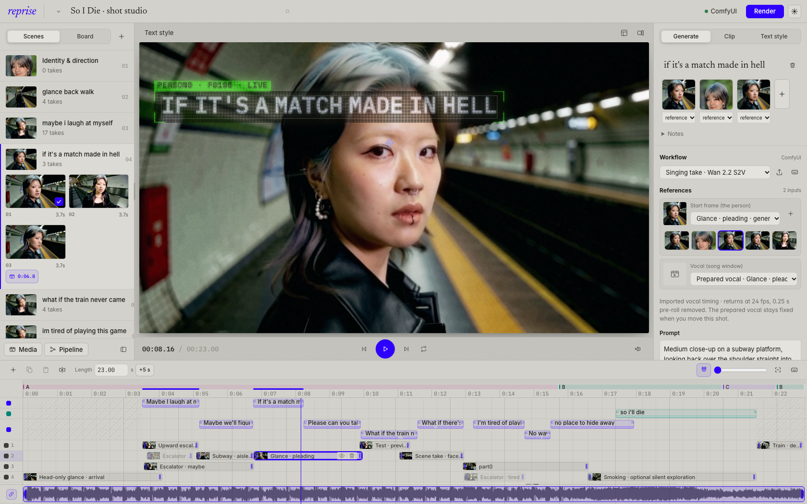](assets/readme/studio-walkthrough.mp4)

**[Watch the Studio walkthrough ↗](assets/readme/studio-walkthrough.mp4)

Reprise is an open-source music video studio and ComfyUI node pack. Gather references, generate alternate takes, try them against your song, and keep reshaping your edit. 

Real creative work is not done by a million attempts to one-shot something: instead, reprise gives you the ability to iterate and work from within a creative loop. Gather inspiration, generate a take, place or replace a clip, adjust its timing and treatment on a timeline, then return to generation with the next idea. 

## Made with Reprise

The front page includes **Fall For Me** and **So I Die**, music videos made by the author of this tool while building this project, alongside a few fully Comfy-generated demos. Each piece opens its editable Studio project when that project is available locally.

Short, silent previews below. **Click a preview or “Watch with sound” for the full video.**

| Fall For Me · Angel | Fall For Me · Stars |
| :---: | :---: |
| [](apps/web/public/showcase/ffm-angel.mp4) | [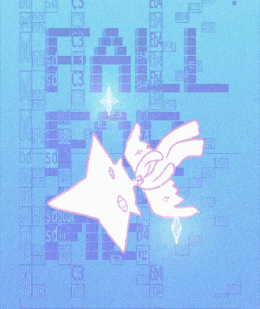](apps/web/public/showcase/ffm.mp4) |
| Generated performances, shifting backgrounds and dreamy lyric cards.<br>[Watch with sound ↗](apps/web/public/showcase/ffm-angel.mp4) | footage composed in TouchDesigner, with text and effects in comfyUI-reprise.<br>[Watch with sound ↗](apps/web/public/showcase/ffm.mp4) |

| So I Die | Neon Rain |
| :---: | :---: |
| [](apps/web/public/showcase/so-i-die.mp4) | [](apps/web/public/showcase/hero-16x9.mp4) |
| Generated music video to an original song, with wall text and tracked lyrics.<br>[Watch with sound ↗](apps/web/public/showcase/so-i-die.mp4) | Music and footage generated through ComfyUI; editable text and composition in Reprise.<br>[Watch with sound ↗](apps/web/public/showcase/hero-16x9.mp4) |

## Inside the studio

**Keep the scene, its references and its takes together.** Arrange scenes on the board, then move between the board and scene list while the composition and timeline stay in view.

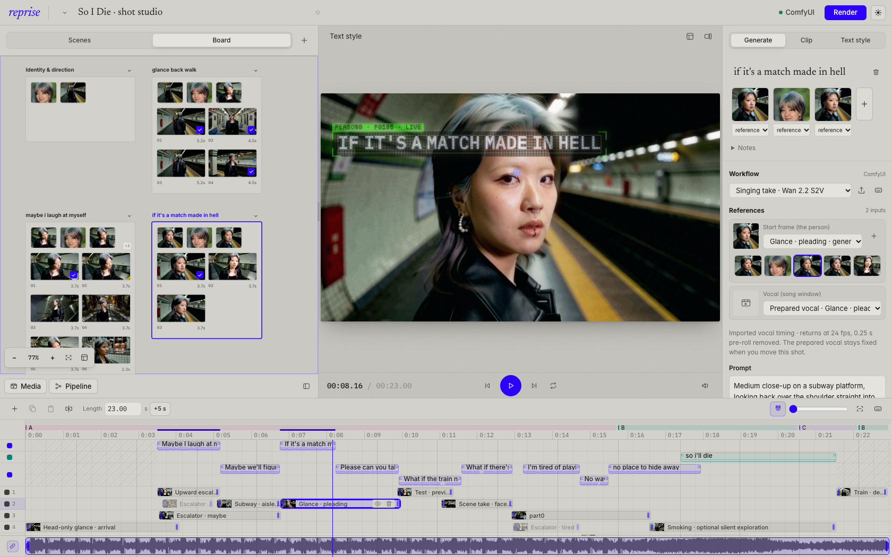

| Compare a take before committing | Keep shaping the edit |
| :--- | :--- |
| [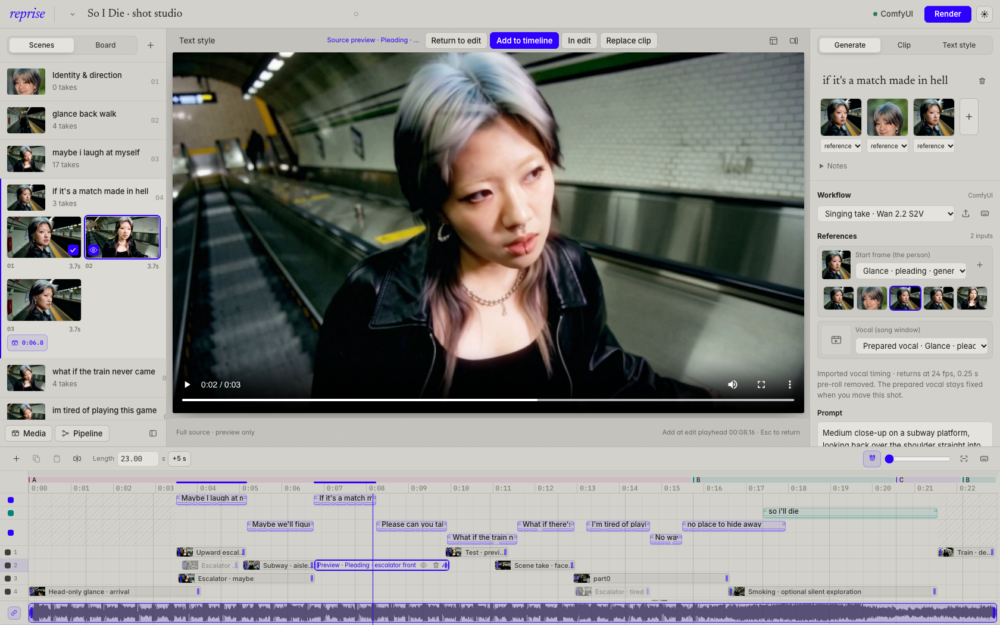](assets/readme/takes.png) | [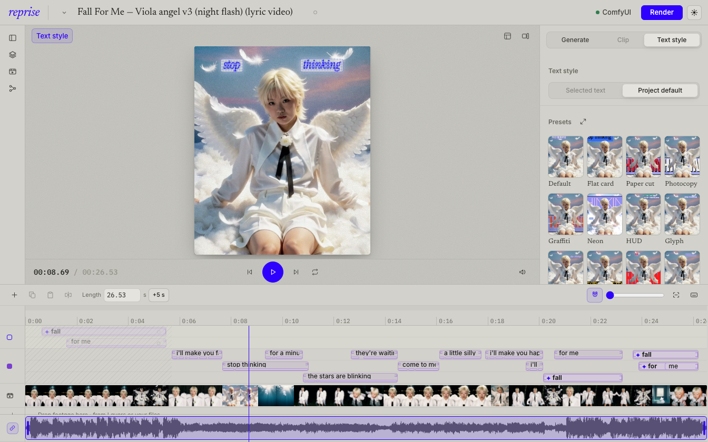](assets/readme/text-style.png) |
| Preview the full source, try it in the edit, then add it or replace the selected clip. Checkmarks show which takes are already used. | Refine lyrics, timing, placement and text styling against the footage. Style previews use the current composition. |

## Kinetic typography

Words are a layer of the edit, not a caption track. Lyrics align to the vocal, then sit behind the subject, on a tracked wall or beside the head as a HUD, and move with the beat, the voice and the motion in the footage. Eight text styles and four grades, all editable in the Studio and previewed on the current composition. The [demo page](apps/web/src/LooksSection.tsx) plays every style on the same shot.

| Flat card | Paper cut | Graffiti | Neon |
| :---: | :---: | :---: | :---: |
| 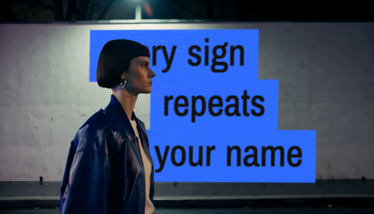 | 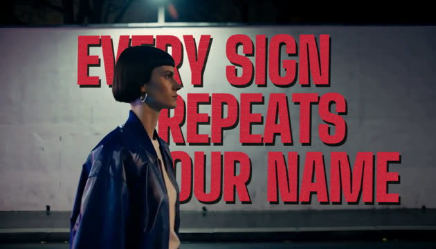 | 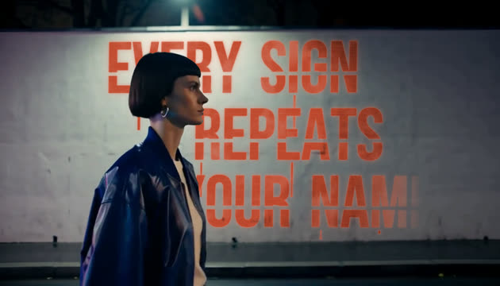 | 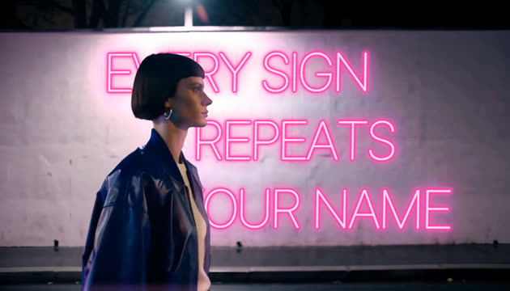 |
| **HUD** | **Photocopy** | **Marquee** | **Scatter** |
| 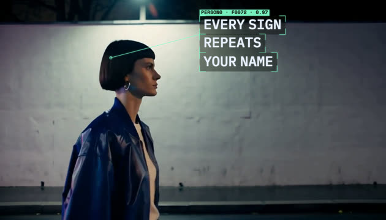 | 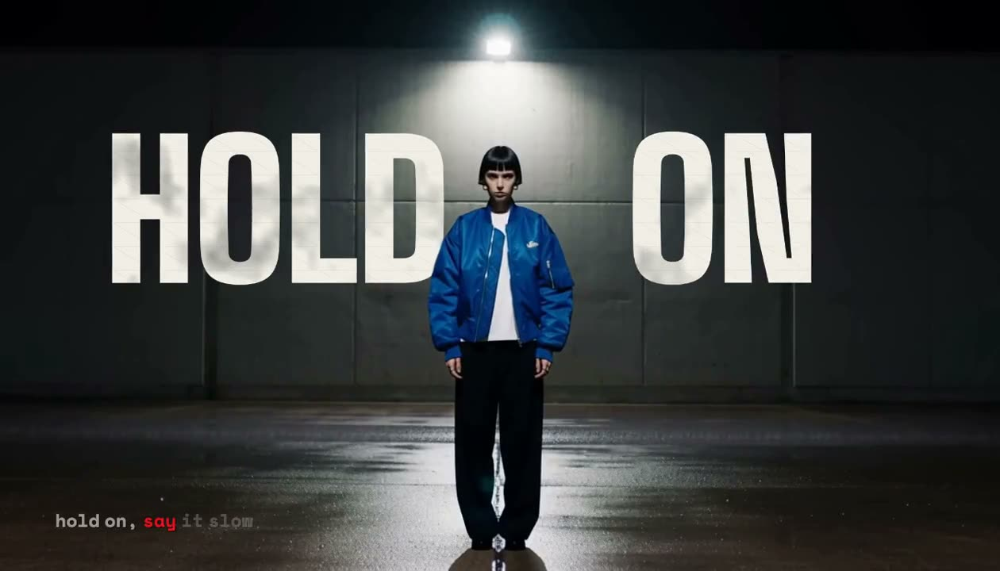 | 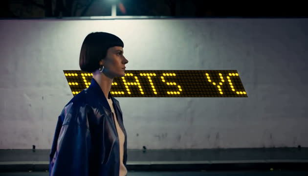 | 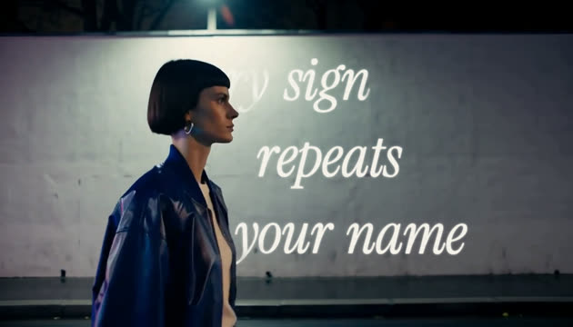 |

## ComfyUI nodes and workflows

Open the **Reprise** sidebar inside ComfyUI (studio route `/typeset/`), or start with the [**words in your shot** App Mode workflow](custom_nodes_dev/typeset_nodes/example_workflows/Reprise%20-%20words%20in%20your%20shot.json): clip + lyrics → look, grade, voice and flow controls → lyric video. Switch to the graph to rewire the steps.

| Nodes | Purpose |
|---|---|
| `TypesetAlignLyrics`, `WhisperWords` | Align a lyric sheet to the vocal, or transcribe word timestamps. |
| `MaskToTracks`, `TypesetOccupancyGrid` | Turn subject masks into anchors and readability maps. |
| `TypesetPlanarTrack`, `TypesetReframeCrop` | Track a wall plane and build a subject-following crop. |
| `TypesetBeatGrid`, `TypesetAudioField`, `TypesetVoiceField`, `TypesetFlowField` | Extract beats, bass energy, vocal features and motion. |
| `TypesetLook`, `TypesetGrade` | Set text styling and footage grading independently. |
| `TypesetRender` | Render through the studio engine in Chromium; an explicitly reported Python draft is available as a fallback. |

Analysis outputs are plain JSON, so they can also feed another renderer. See the [node-pack reference](custom_nodes_dev/typeset_nodes/README.md), [project types](apps/web/src/types.ts) and [API workflows](workflows/).

Reprise was previously called Typeset. The `/typeset/` mount, `typeset_nodes` package, `Typeset…` node class IDs, environment variables and saved browser keys remain stable for existing graphs and projects. The app, sidebar and node display names use Reprise.

## Run locally

Requirements: Python 3.12, Node/npm, ffmpeg/ffprobe and ComfyUI (the commands below assume `~/ComfyUI`).

Use your existing ComfyUI installation and model folders. You do not need another copy of ComfyUI or all the models used in the demos. Replace `~/ComfyUI` and its Python path below with those of your installation (Desktop and portable installs can use different locations). The shell commands below are for macOS/Linux.

```bash
python3.12 -m venv server/.venv
server/.venv/bin/python -m pip install -r server/requirements.txt
server/.venv/bin/python -m playwright install chromium
(cd apps/web && npm install && npm run build)

# Link the nodes; also install ComfyUI-RMBG and VideoHelperSuite.
ln -s "$PWD/custom_nodes_dev/typeset_nodes" ~/ComfyUI/custom_nodes/typeset_nodes
~/ComfyUI/.venv/bin/python -m pip install -r custom_nodes_dev/typeset_nodes/requirements.txt
```

**Inside ComfyUI:** restart ComfyUI, then open `http://127.0.0.1:8188/typeset/`. The built studio is served by the node pack. Rebuild `apps/web` after changing the renderer. Graph-based Chromium rendering needs Playwright in the ComfyUI environment or the repo's `server/.venv`.

The mounted app also needs the server dependencies in **ComfyUI's Python environment**. Install `server/requirements.txt` there if they are missing; installing them only into `server/.venv` supports the standalone app. Keep the full Reprise checkout beside its node pack so the mounted studio can find `server/` and `apps/web/dist`. ffmpeg/ffprobe are discovered on PATH; `FFMPEG` and `FFPROBE` can override their executable paths.

**Standalone development:**

```bash
scripts/comfy.sh start  # ComfyUI + comfy-api-proxy
scripts/dev.sh          # API on :8787; prints the web URL (the studio alone is at /studio/)
```

Open the printed web URL for the demos, or `/#/studio` for the editor. The offline sample needs no model download; analysis and project exports need the backend. Use one host at a time for a shared project store.

To use an **already-running ComfyUI without a proxy**, launch the standalone app with:

```bash
TYPESET_COMFY_MODE=direct TYPESET_COMFY_DIR="$HOME/ComfyUI" TYPESET_COMFYUI_URL=http://127.0.0.1:8188 scripts/dev.sh
```

Set the folder and address to your existing installation. The public website's **Use my ComfyUI** button opens the mounted `/typeset/` app on the address you enter; it does not upload projects to this website or turn a bare ComfyUI server into a Reprise backend.

### Choose your own models or Cloud

In a scene, import a working ComfyUI **API-format** workflow, or choose **Add model workflow** for an image, animation or singing preset. **Run on** starts with **My ComfyUI**. Its **Models** dropdowns read the connected host's loader choices, including configured extra model folders. Pick compatible files from the workflow's model family; changing architectures generally needs a different workflow. Your choices are saved with the scene/take recipe and recorded in generated assets, without changing the imported graph's defaults.

Missing files are shown before a job can start. **Download help** links to model repositories and ComfyUI's template instructions. Supported templates in Comfy Desktop can install missing files into the correct folders; other installations may require manual placement. Return to Reprise and choose **Refresh models** after downloading. Preset JSON files do not download weights or install custom nodes.

**Comfy Cloud is optional:** create your own key at [platform.comfy.org](https://platform.comfy.org/), put `TYPESET_CLOUD_API_KEY=your-key` in the ignored `.env.comfy` file at the repo root, and restart `scripts/dev.sh`. The workflow's **Run on** menu then includes **Comfy Cloud**. Other launch methods can set the same environment variable before starting the process. The key stays in your own backend. Cloud needs a paid subscription, available credits and supported nodes/models; [Comfy's API guide](https://docs.comfy.org/development/deploy/cloud) describes the requirements.

Local workflows using installed model weights do not require Cloud or Router credits. Workflows that contain paid API nodes still require their provider's credits. The public static site includes an editable sample; your own uploads, generation and video export run through your Reprise installation.

The [node-pack reference](custom_nodes_dev/typeset_nodes/README.md) lists analysis dependencies. [Server configuration](server/app/config.py) defines environment variables and defaults; [`scripts/comfy-remote.sh`](scripts/comfy-remote.sh) manages the optional remote ComfyUI proxy. Additional setup and research notes in the root `docs/` and `research/` folders are local-only and are not included in a fresh checkout.

## Models and credits

The generative models make footage, performances, reference images or music. Reprise's browser renderer draws the editable typography and composites the final edit. Model availability depends on the selected ComfyUI host; viewing the shipped demos does not download or run models.

### Used in the demo-production workflows

| Model | Role and evidence |
|---|---|
| [MiniMax H3](https://huggingface.co/Comfy-Org/MiniMax-H3) | Core scene-video model for Angel, So I Die, Neon Rain and DANCING. Image/reference-to-video generates alternative performances and motion. The committed [scene workflows](workflows/scene_motion.api.json) use the INT8 ConvRot checkpoint and the LightX2V eight-step Turbo LoRA, Qwen3-VL-32B text encoder, and H3 video/audio VAEs on a remote GPU. This runs model weights in ComfyUI, rather than calling a closed video-generation API. |
| [Wan 2.2 S2V 14B](https://huggingface.co/Wan-AI/Wan2.2-S2V-14B) | Singing performances in So I Die, also used in Playboi development. [S2V with motion reference](workflows/s2v_motion.api.json) uses FP8-scaled weights, UMT5-XXL, a wav2vec2 audio encoder, the Wan 2.1 VAE and an optional LightX2V four-step LoRA. The [full-model variant](workflows/s2v_performance.api.json) omits that LoRA. Audio preparation and retiming are separate from the video model. |
| [Qwen-Image-Edit-2511](https://huggingface.co/Qwen/Qwen-Image-Edit-2511) | Reference/costume edits during Angel development, and the LOUDER still in Neon Rain before H3 animation. [Workflow](workflows/eval/qwen2511_int8_edit.api.json): INT8 ConvRot, Qwen2.5-VL-7B, Qwen image VAE and Lightning four-step LoRA. |
| [ACE-Step 1.5](https://github.com/ace-step/ACE-Step-1.5) | Generates the Neon Rain song, reused in DANCING and the text-style comparisons. [Workflow](workflows/eval/ace_song.api.json) uses `ace_step_1.5_turbo_aio.safetensors`. Fall For Me and So I Die use artist-supplied recordings. |

**Background generation:** [Z-Image-Turbo](https://huggingface.co/Tongyi-MAI/Z-Image-Turbo) generated the underwater/cloud/city background stills used to build Angel's star-character interludes; H3 supplied the moving backgrounds. The [Z-Image graph](workflows/eval/zimage_t2i.api.json) uses the BF16 checkpoint, Qwen3-4B encoder and `ae.safetensors` VAE.

**Still preparation and experiments:** [Krea 2 Turbo](https://huggingface.co/Comfy-Org/Krea-2) was used in Angel reference and hair-edit exploration. The committed [Krea graph](workflows/eval/krea2_remote_t2i.api.json) records the checkpoint and encoder names. Experimental outputs are not all included in the final cut.

**Other supplied or evaluated paths:** LTX-Video 0.9.8 distilled 2B (image-to-video/morph) and 13B Q4 GGUF (evaluation), and FLUX.2 Klein 4B (still-generation/edit evaluation) are in [`workflows/`](workflows/) and [`workflows/eval/`](workflows/eval/). These are not the core video models in the showcased cuts; the FLUX experiments use FLUX.2, not the competition's FLUX 3 bonus model. [`scripts/lipsync_pass.py`](scripts/lipsync_pass.py) is a separate optional LatentSync 1.6 / Wav2Lip entry point requiring an external installation; it is not a built-in Studio action or a blanket credit for every singing shot.

### Analysis and composition

| Model or technique | What it contributes |
|---|---|
| [BiRefNet](https://github.com/ZhengPeng7/BiRefNet), via [ComfyUI-RMBG](https://github.com/1038lab/ComfyUI-RMBG) | Subject mattes for occlusion and placement; the production matte graph uses `BiRefNet-general`, and the analysis example uses `BiRefNet_lite`. The original stylized Fall For Me stars use a colour-key matte. |
| HDemucs `HDEMUCS_HIGH_MUSDB_PLUS` | Vocal separation for lyric alignment and vocal-reactive animation. A supplied vocal stem can bypass separation. |
| BS-RoFormer, via [audio-separator](https://github.com/nomadkaraoke/python-audio-separator) | External vocal preparation for Fall For Me/Angel: `model_bs_roformer_ep_317_sdr_12.9755`. This supplied stem is separate from the app's default HDemucs pipeline. |
| [MMS_FA](https://docs.pytorch.org/audio/stable/generated/torchaudio.pipelines.MMS_FA.html) | Forced alignment of known lyrics to the vocal; word timing remains editable. These weights are **CC-BY-NC 4.0**, distinct from the repository's code licence. |
| [Whisper](https://github.com/openai/whisper), through faster-whisper | Word transcription when lyrics are unavailable or alignment falls back; the node defaults to `small`. |
| [YuNet](server/models/README.md) | Bundled face detector for head tracking, with the upstream MIT licence and checksum. |
| OpenCV, librosa, NumPy/SciPy | Planar/optical-flow tracking, beat and energy analysis, pitch estimation and signal processing. These operations do not call a generative model. |
| React, TypeScript, Canvas, Chromium/Playwright and ffmpeg | Interactive editor, editable text/effects, compositing, frame capture and encoded exports. |
| Comfy SDK + comfy-api-proxy; ComfyUI HTTP API | The standalone analysis runner supports the SDK/proxy transport; the mounted studio and imported-workflow runner can use ComfyUI directly. See [`server/app/comfy.py`](server/app/comfy.py) and [`server/app/workflows.py`](server/app/workflows.py). |

**Artist material:** Fall For Me and So I Die use artist-supplied songs and likeness references. The original Fall For Me star footage was composited in TouchDesigner before Reprise's typography pass. The original photos, song masters and local project data are not part of the public source package. Selected demo encodes are supplied to demonstrate the app; the code's MIT licence does not grant rights to the music or likenesses.

**Licences:** Reprise code is MIT. Model weights and adapters retain their upstream terms, including the MiniMax H3 Community License and the MMS_FA noncommercial licence. The model-card links and graph filenames identify the dependencies; open weights do not imply that every weight has the same licence as the app. Bundled fonts have their licence files in [`apps/web/public/fonts/`](apps/web/public/fonts/).
