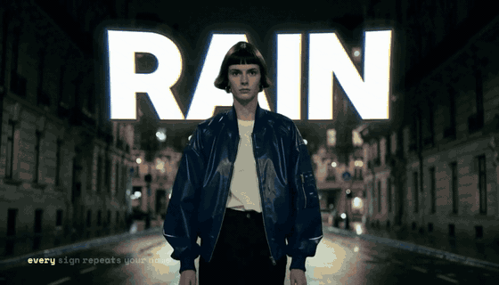
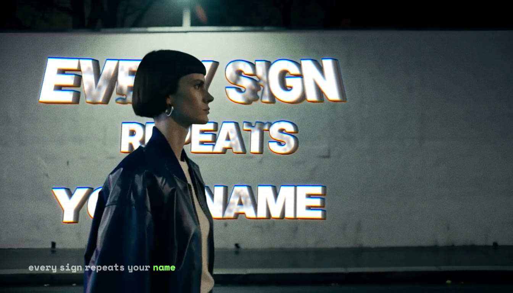
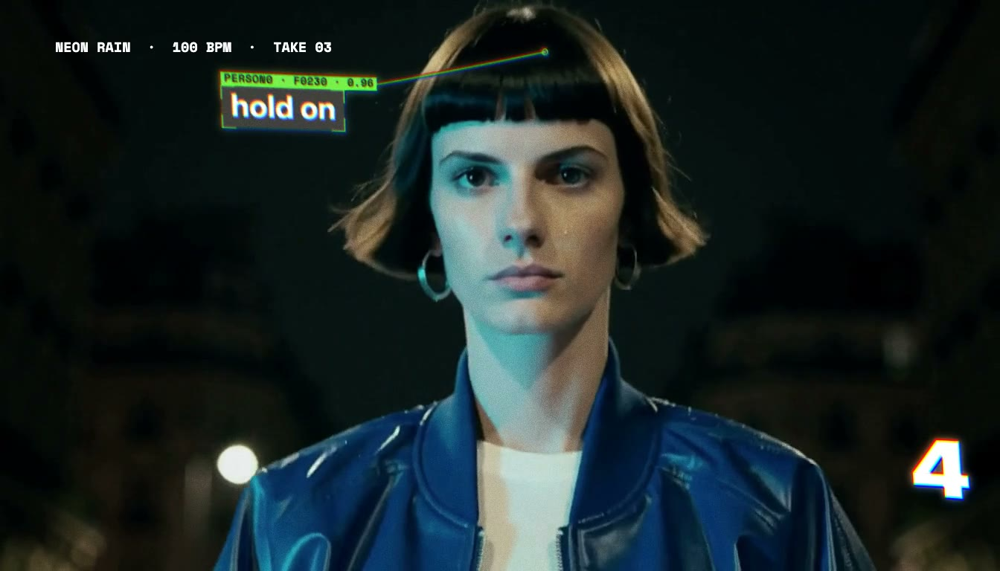
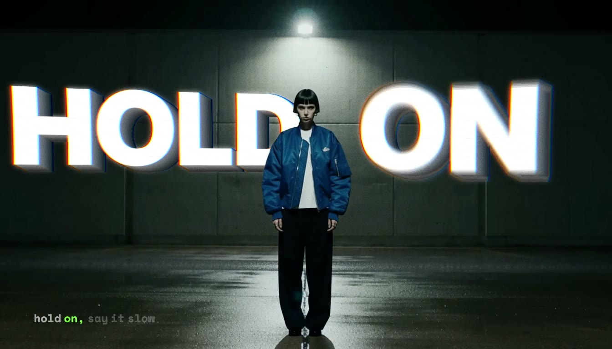
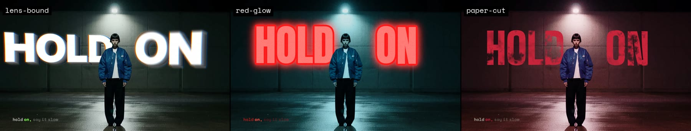
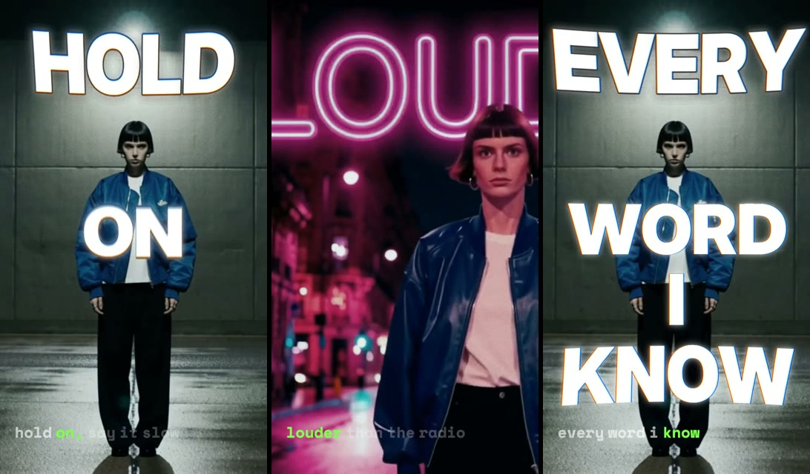
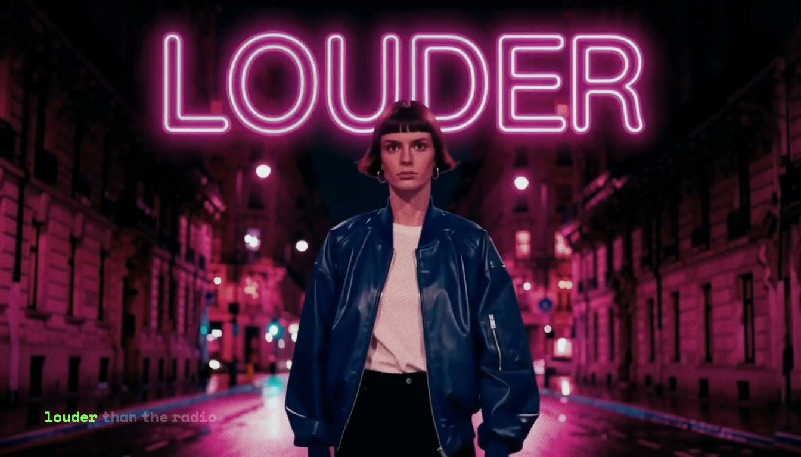
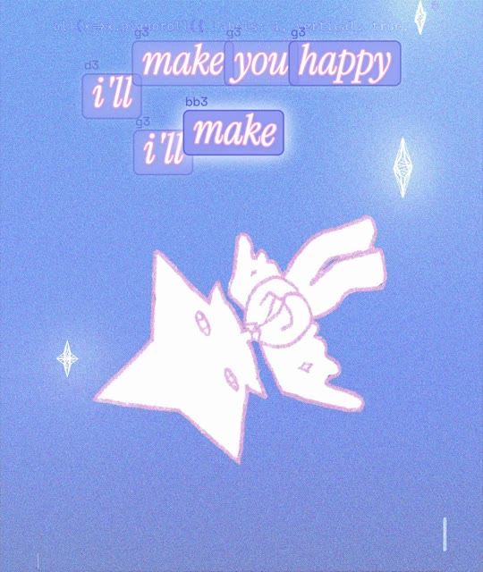

# Typeset

**Words that live in the scene.** Typeset puts lyrics and kinetic type *inside* a shot. Words pass behind the person, get painted onto walls that the camera moves past, and lock to a head as a HUD. It then restyles the result with one-click looks and re-lays it out for 9:16. Video models can't spell reliably, so every letter is real type. It is composited into the scene, stays editable, and renders identically in preview and export. ComfyUI does the perception (words, matte, tracking, reframe), and the generative models make the footage.



*Hero clip (22 s). The footage and song are generated (MiniMax H3, ACE-Step). Every word on screen was placed in the Typeset studio.*

| Wall-tracked stencil, occluded by her | Head-anchored HUD + count-in | Words behind the subject |
|---|---|---|
|  |  |  |

## Features

- **Behind the subject.** A per-frame BiRefNet matte puts any line behind the person. An occupancy grid steers auto-placement toward the space that stays readable.
- **Wall tracking.** Draw a quad on one frame. The `TypesetPlanarTrack` node tracks it through the shot as a per-frame homography, with the subject masked out, and stops at cuts. Text is warped onto the plane as *paint* (eroded stencil), *flat* or *neon*.
- **HUD.** Labels and leader lines anchor to the subject's head, using the matte's tracked region rather than face recognition.
- **Lyrics that land when they're sung.** Acoustic forced alignment of your lyric sheet to the vocal: `TypesetAlignLyrics` isolates the vocal with HDemucs and aligns with MMS_FA, falling back to faster-whisper. It also builds a beat grid, and a small text lead (`timing.leadMs`) gives perceived sync. Every word's timing, placement, motion and style stays editable on the timeline.
- **Looks.** One field restyles a whole video, covering font, palette, case, texture, grade and optics (glow, chroma, lens warp, extrusion). There are seven presets: `lens-bound`, `red-glow`, `paper-cut`, `ticker`, `flat-card`, `dreamy` and `default`. Placement, tracking and timing don't change.
- **9:16 reframe.** A subject-following crop with re-layout: off-crop walls become title rows, hero words keep off the face, and text keeps a 6% edge margin. *Focus regions* can keep a wide element in the crop by panning across it or zooming out.
- **Generated word shots (`generate/inworld`).** A frame of your shot goes to Qwen-Image-Edit (or FLUX.2 Klein), which writes the word into the scene. MiniMax H3 then animates it, and the shot is attached to the timeline. The hero's LOUDER sign was made this way: the edit spells it, and the video model lights and moves it.
- **Deterministic export.** Each frame is rendered as a function of time, so preview equals export. Outputs are an H.264 MP4 with audio, plus ProRes 4444 and VP9-alpha text-only overlays.
- **ComfyUI node pack and workflows.** `custom_nodes_dev/typeset_nodes` and the API graphs in `workflows/` run the analysis. The studio's pipeline panel shows each workflow that ran, with its status and timing.



| One-click 9:16 (drop · LOUDER pan · ending) | Generated word shot | Own footage: *Fall For Me* |
|---|---|---|
|  |  |  |

## How it works

```
footage + song ──► ComfyUI (via comfy-sdk)                         ──► Typeset studio (React)        ──► export
                   align.api.json     forced alignment (HDemucs+MMS_FA)      timeline, placements, looks       Chromium frame capture
                   matte.api.json     BiRefNet → RGBA cutouts + tracks   deterministic canvas renderer     → ffmpeg MP4 / ProRes 4444 /
                   occupancy.api.json where text stays readable          (background → behind text →         VP9-alpha
                   surface_track      planar homography per frame         subject → front text)
                   reframe.api.json   smoothed 9:16 crop
                   beats.api.json     beat / downbeat grid
                   generate/inworld   Qwen-Image-Edit / Klein → MiniMax H3 (remote GPU)
```

The FastAPI server (`server/`) stores projects, submits the workflows and runs jobs. The studio (`apps/web/`) does all text rendering in the browser. The same renderer drives export, which is why preview and export match.

## Node pack

`custom_nodes_dev/typeset_nodes` (V1 node API):

| Node | Does |
|---|---|
| `WhisperWords` | audio (+ optional lyrics) → word timestamps JSON (faster-whisper, CPU int8) |
| `TypesetAlignLyrics` | acoustic forced alignment of a lyric sheet to the vocal (HDemucs stem + MMS_FA; Whisper fallback) |
| `TypesetBeatGrid`, `AudioBeatMarkers` | beats / downbeats / sections JSON |
| `MaskToTracks` | matte batch → per-frame subject region (anchor for behind/HUD text) |
| `TypesetOccupancyGrid` | matte batch → where text stays readable + heatmap |
| `TypesetPlanarTrack` | image batch + quad (+ subject mask) → per-frame corners |
| `TypesetReframeCrop` | tracks / mask + aspect → smoothed crop |
| `TypesetLoadImageSequence`, `SaveTextFile`, `TextToMask` | I/O helpers; text → mask with bundled OFL fonts |

The production graphs are in `workflows/*.api.json`, each with an `.inputs.json` sidecar. `workflows/showcase/typeset_analysis.json` is the analysis graph for opening in the ComfyUI editor.

## Setup

Requirements: Python 3.12, Node/npm, ffmpeg/ffprobe, and a ComfyUI install (by default `~/ComfyUI`). The analysis path runs locally on Apple Silicon. Generated shots (MiniMax H3) run on a remote NVIDIA ComfyUI; ours was an RTX 4090.

```bash
# app
python3.12 -m venv server/.venv
server/.venv/bin/python -m pip install -r server/requirements.txt
server/.venv/bin/python -m playwright install chromium
(cd apps/web && npm install)

# ComfyUI: link the node pack; also install ComfyUI-RMBG (BiRefNet) and VideoHelperSuite
ln -s "$PWD/custom_nodes_dev/typeset_nodes" ~/ComfyUI/custom_nodes/typeset_nodes
~/ComfyUI/.venv/bin/python -m pip install -r custom_nodes_dev/typeset_nodes/requirements.txt

# run
scripts/comfy.sh start   # ComfyUI + comfy-api-proxy
scripts/dev.sh           # API on :8787 + studio (prints the URL; studio at /#/studio)
```

The studio opens with an offline sample, which needs no GPU or API. Projects, analysis, generation and export need the API and ComfyUI. Model downloads and the custom-node dependencies are covered in [docs/comfy-integration.md](docs/comfy-integration.md). The remote-GPU setup for generated shots is in [docs/remote-comfy.md](docs/remote-comfy.md), and API settings (ports, `FFMPEG`, CORS) are in [docs/server.md](docs/server.md).

## Models and licences

| Model | Used for | Licence |
|---|---|---|
| Whisper small via faster-whisper | fallback word timestamps (no lyric sheet) | MIT |
| BiRefNet (lite) via ComfyUI-RMBG | subject matte | MIT |
| Hybrid Demucs (`HDEMUCS_HIGH_MUSDB_PLUS`, torchaudio) | vocal stem for forced alignment | Demucs code MIT; see the torchaudio bundle docs for the weights |
| MMS_FA (torchaudio wav2vec2 forced aligner) | word-level forced alignment | CC-BY-NC 4.0 (non-commercial) |
| Qwen-Image-Edit-2511 | writing a word into a frame (`generate/inworld`) | Apache-2.0 |
| FLUX.2 Klein 4B | alternative edit model for `generate/inworld` | Apache-2.0 |
| MiniMax H3 (image-to-video, reference-to-video) | generated shots; the hero footage and character consistency | open weights, see the MiniMax H3 model card |
| LTX-Video 2B 0.9.8 distilled (optional) | text-plate-to-video path | LTXV Open Weights License |
| ACE-Step 1.5 | the hero's song (made for the demo, not used by the app) | Apache-2.0 |

Libraries: OpenCV (planar tracking), librosa (beats), ffmpeg and Playwright/Chromium (export). Bundled fonts are OFL, except Permanent Marker (Apache-2.0). Their licence files are in `apps/web/public/fonts/`. Check each model card before commercial use.

## Limits

- The HUD anchors to the matte's tracked region. It is not face recognition or identity tracking, so review multi-person shots.
- Forced alignment needs the lyric sheet. Without one, timing comes from Whisper, and sung lines can need a nudge.
- Surface tracking is planar, which suits walls and signs but not cloth or curved surfaces.
- Generated word shots depend on the edit model spelling the word right. Check the frame before animating.
- Text-only (alpha) exports are unoccluded. To reproduce behind-subject placement in another editor, also export the matte.

## Repository

| Path | Contents |
|---|---|
| `apps/web/` | Studio, renderer, looks, fonts |
| `server/` | FastAPI service, projects, jobs, exporter, remote generation |
| `custom_nodes_dev/typeset_nodes/` | ComfyUI node pack |
| `workflows/` | Production API graphs and sidecars |
| `docs/` | Architecture, schema, setup, the hero clip's making-of ([docs/HERO.md](docs/HERO.md)) |
| `scripts/content/` | Scripts that produced the demo clips |

Code is [MIT](LICENSE).
