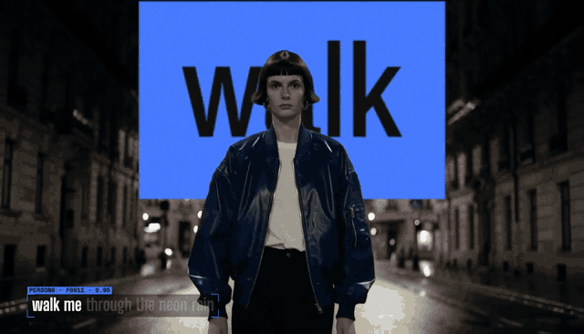
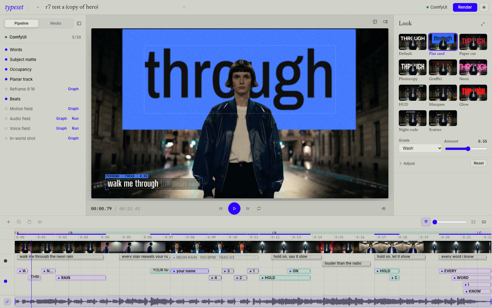

# Typeset

**Words that live in the scene.** Typeset is a typography studio and ComfyUI node pack for lyrics, titles and motion graphics. Put words behind a person, track them onto a wall, anchor a label to a head, or let the music and movement shape the type. Every letter stays editable.

ComfyUI prepares the scene: word timings, subject mattes, wall tracks, beats and motion fields. You direct the result in a timeline. Changing a word, a look or an animation uses that saved analysis, without generating the shot again.

[](apps/web/public/showcase/hero-16x9.mp4)

*Excerpts from **Neon Rain**, the current 22-second lyric edit. The footage and song were generated with MiniMax H3 and ACE-Step; the typography is rendered by Typeset. [Watch with sound](apps/web/public/showcase/hero-16x9.mp4) · [Original footage](apps/web/public/showcase/hero-source.mp4).*

## Try the current examples

| Example | What to look for |
|---|---|
| [Neon Rain · 22 s](apps/web/public/showcase/hero-16x9.mp4) | Flat card lyrics, wall tracking, behind-subject type, a head-anchored HUD and a timed count-in. |
| [DANCING · 8 s](apps/web/public/showcase/louder-fields.mp4) | Large Glow lettering behind the dancer, shaped by motion and vocal energy. Compare the [clean source](apps/web/public/showcase/louder-source.mp4). |
| [Fall For Me · 24 s](apps/web/public/showcase/ffm.mp4) | A tighter lyric edit over stylized footage, with editable word timing and a trimmed song. Compare the [original](apps/web/public/showcase/ffm-source.mp4). |
| [Looks comparison · 4 s](apps/web/public/showcase/README.md#looks-section-srclookssectiontsx) | Eight looks on the same wall shot, each in four footage grades. Open the local demo page to switch looks and grades on one audio clock. |

[](apps/web/public/showcase/louder-fields.mp4)

*DANCING excerpt. The full clip includes audio; the GIF is silent.*

**Looks style the text; grades style the footage.** These are actual renders of the same shot and lyric sequence:

| Flat card | Paper cut | Neon |
|---|---|---|
| [](apps/web/public/showcase/looks/flat-card.mp4) | [](apps/web/public/showcase/looks/paper-cut.mp4) | [](apps/web/public/showcase/looks/neon.mp4) |
| Photocopy | Graffiti | Marquee |
| [](apps/web/public/showcase/looks/xerox.mp4) | [](apps/web/public/showcase/looks/graffiti.mp4) | [](apps/web/public/showcase/looks/ticker.mp4) |

Paper cut uses opaque fibres and a cut-paper shadow. Photocopy uses printed strips and photocopied texture. Neon has thin tubes and scene lighting; Marquee uses scrolling dot-matrix lettering. The demo also includes HUD and Scatter, with ungraded, Mono, Noir and Film comparisons. [Media and render notes](apps/web/public/showcase/README.md).

Studio also includes **Glyph**: a grid of letters from your lyric line, lit by the footage and confined to the subject, the surrounding scene, the frame or a tracked wall. Its cell size and backing are editable independently of the words.

## Direct it in Studio



- **Edit the timeline.** Add text on a track, double-click a word to edit, drag and trim clips, copy/paste, split at the playhead, hide tracks and undo/redo. Filmstrips, the waveform, beat markers and zoom help place words precisely.
- **Place text in the shot.** Draw and adjust a wall quad, track it through the scene, put a title behind the subject, or use a head-anchored HUD. Adjust each line's size, position and left/centre/right alignment.
- **Keep the words visible while styling.** Look thumbnails preview your text; the inspector follows the selected line or group and exposes the controls relevant to its look.
- **Work with the song.** Trim, move or slip the audio clip, optionally moving linked lyrics with it. Forced alignment gives a starting point; word timing remains editable.
- **Animate from signals.** Motion fields drive drift and local distortion. Bass and vocal fields drive the type's pulse. These controls reuse precomputed analysis.
- **Finish independently.** Change the footage grade, reframe to 9:16, and export an MP4 with audio or text-only ProRes 4444 / VP9-alpha overlays.

Timeline shortcuts: **⌘/Ctrl+C** copy, **⌘/Ctrl+V** paste, **⌘/Ctrl+B** split, **⌘/Ctrl+Z** undo; **+ / −** zoom and `\` fit. Double-click empty track space to add text.

## Prepare → animate → finish

```text
Footage + song + lyrics
  │
  ├─ Prepare in ComfyUI
  │    alignment · subject matte · wall tracks · beats · motion/audio fields
  │    saved as reusable project data
  │
  ├─ Animate in Studio
  │    editable words · timeline · placement · looks · signal-driven motion
  │    lightweight media during playback and dragging
  │
  └─ Finish
       footage grade · reframe · full-quality browser render → ffmpeg
       MP4 with audio / ProRes 4444 / VP9 alpha
```

The React studio, server export and ComfyUI's `TypesetRender` share the browser renderer. Text geometry and timing come from the same project data. Interactive playback uses smaller proxies and cheaper effects; a settled preview restores quality, and export uses the original media. Preview compression can therefore differ from the final output.

Recent performance work separates thumbnail generation from dragging, coalesces obsolete frame requests, and uses short-GOP preview/seek copies. Sequential decoding accelerates eligible exports, with a seek fallback. Measurement scripts live in [`scripts/perf/`](scripts/perf/).

The standalone demo page also has synchronized **Typeset / Original** switches. Saving a mapped showcase project queues a refreshed demo render. The [piece registry](apps/web/src/showcase-pieces.json) controls which projects and encodes it uses.

## ComfyUI nodes and workflows

Use the studio inside ComfyUI at `/typeset/`, or start with the [**words in your shot** App Mode workflow](custom_nodes_dev/typeset_nodes/example_workflows/typeset%20-%20words%20in%20your%20shot.json): clip + lyrics → look, grade, voice and flow controls → lyric video. Switch to the graph to rewire the steps.

| Nodes | Purpose |
|---|---|
| `TypesetAlignLyrics`, `WhisperWords` | Align a lyric sheet to the vocal, or transcribe word timestamps. |
| `MaskToTracks`, `TypesetOccupancyGrid` | Turn subject masks into anchors and readability maps. |
| `TypesetPlanarTrack`, `TypesetReframeCrop` | Track a wall plane and build a subject-following crop. |
| `TypesetBeatGrid`, `TypesetAudioField`, `TypesetVoiceField`, `TypesetFlowField` | Extract beats, bass energy, vocal features and motion. |
| `TypesetLook`, `TypesetGrade` | Set text styling and footage grading independently. |
| `TypesetRender` | Render through the studio engine in Chromium; an explicitly reported Python draft is available as a fallback. |

Analysis outputs are plain JSON, so they can also feed another renderer. See the [node-pack reference](custom_nodes_dev/typeset_nodes/README.md), [project schema](docs/SCHEMA.md) and [API workflows](workflows/).

## Run locally

Requirements: Python 3.12, Node/npm, ffmpeg/ffprobe and ComfyUI (the commands below assume `~/ComfyUI`).

```bash
python3.12 -m venv server/.venv
server/.venv/bin/python -m pip install -r server/requirements.txt
server/.venv/bin/python -m playwright install chromium
(cd apps/web && npm install && npm run build)

# Link the nodes; also install ComfyUI-RMBG and VideoHelperSuite.
ln -s "$PWD/custom_nodes_dev/typeset_nodes" ~/ComfyUI/custom_nodes/typeset_nodes
~/ComfyUI/.venv/bin/python -m pip install -r custom_nodes_dev/typeset_nodes/requirements.txt
```

**Inside ComfyUI:** restart ComfyUI, then open `http://127.0.0.1:8188/typeset/`. The built studio is served by the node pack. Rebuild `apps/web` after changing the renderer. Graph-based Chromium rendering needs Playwright in the ComfyUI environment or the repo's `server/.venv`.

**Standalone development:**

```bash
scripts/comfy.sh start  # ComfyUI + comfy-api-proxy
scripts/dev.sh          # API on :8787; prints the web URL
```

Open the printed web URL for the demos, or `/#/studio` for the editor. The offline sample needs no model download; analysis and project exports need the backend. Use one host at a time for a shared project store.

See [ComfyUI setup and model dependencies](docs/comfy-integration.md), [server settings](docs/server.md) and the optional [remote generation setup](docs/remote-comfy.md).

## Current limits

- Wall tracking assumes a plane; cloth and curved surfaces need another approach.
- Behind-subject text needs a usable matte. HUD placement follows the matte's tracked region, so multi-person shots need review.
- Singing alignment can need manual timing corrections, especially with dense mixes or long instrumental intros.
- The Python draft renderer supports fewer effects than Chromium. Graph App Mode currently uses the clip's audio; Studio's audio-clip edits are a separate path.
- Text-only alpha exports are unoccluded; another editor also needs the matte to recreate behind-subject placement.
- The optional generated in-world shot path depends on configured edit/video models and is separate from editable text compositing.

## Development checks

```bash
(cd apps/web && npm run build)
node --experimental-strip-types --test apps/web/scripts/test_timeline_edits.mjs
(cd server && .venv/bin/python -m unittest discover -s tests -p 'test_*.py' -v)
~/ComfyUI/.venv/bin/python -m unittest discover -s custom_nodes_dev/typeset_nodes/tests -v
```

The Node test command requires a version that supports `--experimental-strip-types`. Browser checks in `apps/web/scripts/` use the local demo projects; they are not self-contained fixtures.

## Repository

| Path | Contents |
|---|---|
| `apps/web/` | Studio, demo page, shared renderer, looks and fonts |
| `server/` | Project API, analysis jobs, proxies and export capture |
| `custom_nodes_dev/typeset_nodes/` | ComfyUI nodes and the mounted studio host |
| `workflows/` | API graphs, input sidecars and editor workflows |
| `scripts/content/`, `scripts/perf/` | Demo production and performance probes |
| `docs/` | Schema, integration notes, design and earlier making-of material |

Code is [MIT](LICENSE). Fonts and model weights have separate licences; see the [bundled font files](apps/web/public/fonts/) and [integration notes](docs/comfy-integration.md).
