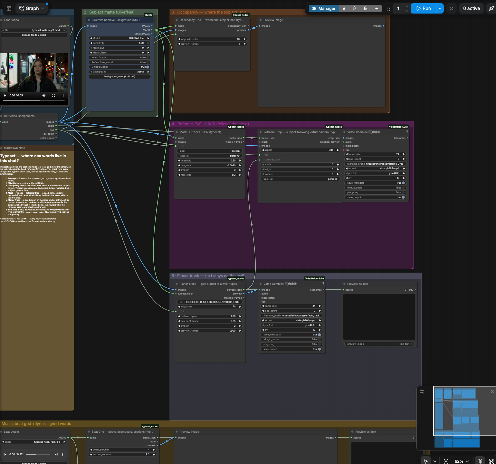
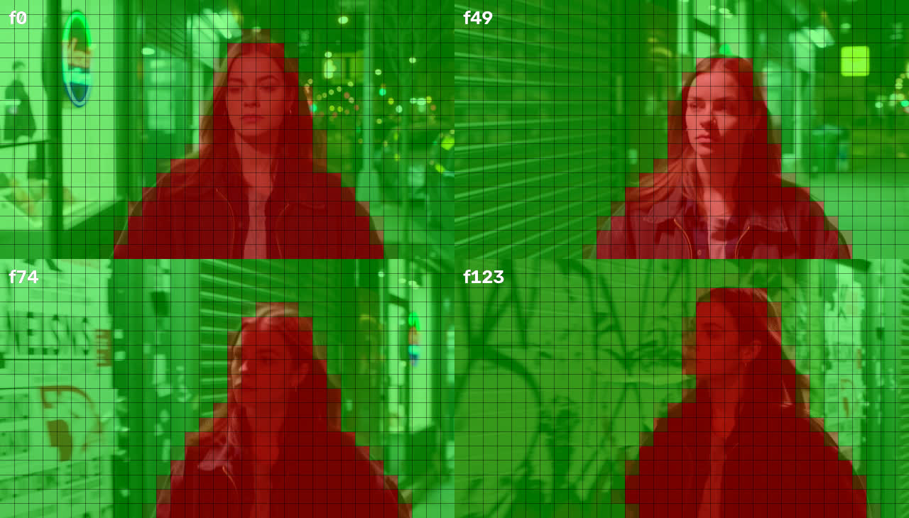
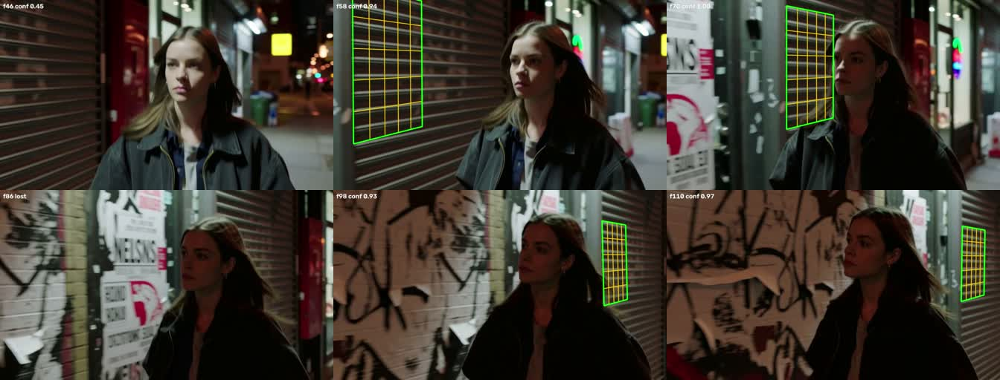
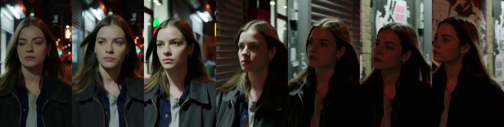

# typeset_nodes: where can words live in this shot?

A ComfyUI node pack for putting lyrics and captions **inside** real footage. It finds where the subject isn't, glues a quad to a wall, reframes landscape to vertical around the head, puts a beat grid on the music and aligns sung lyrics to their timing. Every node outputs plain JSON (documented below) and a preview, so the results also feed other tools: the Typeset editor, a TouchDesigner/Resolve script, or your own renderer.

All analysis is deterministic CPU/OpenCV code. The only models are optional: Whisper for words and any matte node, such as BiRefNet, for the subject mask. MIT licensed. Fonts are SIL OFL.



**Try it:** drag [`workflows/showcase/typeset_analysis.json`](../../workflows/showcase/typeset_analysis.json) into ComfyUI. Put a clip at `input/typeset_walk_night.mp4` and a song at `input/typeset_neon_rain.flac`, or pick your own in the loaders, then press Run. The whole graph (BiRefNet matte, occupancy, reframe, planar track, beat grid and lyric alignment) takes **34 s** on an M5 Max for a 124-frame 1344×768 clip and a 32 s song. The same graph in API format is next to it (`typeset_analysis.api.json`).

## Nodes

### Occupancy Grid: where the subject isn't (`TypesetOccupancyGrid`)
`MASK` batch (1 = subject) → `occupancy_json` STRING + `preview` IMAGE (heatmap over the frames: red is the subject, green is free).
Inputs: `fps`, `long_side_cells` (32 → 32×18 for 16:9, 18×32 for 9:16), optional `images` and `preview_frames`.
```json
{"fps": 24, "cols": 32, "rows": 18, "step": 1, "frames": ["<base64 of cols*rows uint8, row-major, 0..255 = covered fraction>"]}
```
Use it to place "behind the person" text where it stays readable, or to move captions away from a face.


### Planar Track: glue a quad to a wall (`TypesetPlanarTrack`)
`IMAGE` batch + `corners` (normalized `[[x,y]×4]`, order TL, TR, BR, BL, drawn at `key_frame`) + optional `subject_mask` → `surface_json` + `preview` (the quad and its grid drawn on every frame) + `tracked_frames`.

How it works:
1. Feature detection inside the quad grown by `feature_region` (default 100 %). The rest of the same wall adds texture; the subject is masked out.
2. Pyramidal Lucas-Kanade tracking forwards and backwards from the key frame, with a forward-backward consistency check.
3. A key-frame → current-frame homography with RANSAC; the homographies are not chained, so they do not drift.
4. A dense refinement of each pose against the key frame (masked ECC: enhanced correlation coefficient alignment), which removes the slow slippage that repeating textures like roller shutters cause.
5. When less than 45 % of the region is visible (occluded or off screen), a 4-DOF update replaces the full homography so the pose does not extrapolate wildly.
6. ±2-frame smoothing. Frames below `min_confidence` are dropped (lost).
```json
{"fps": 24, "frames": [{"f": 70, "corners": [[0.36,0.03],[0.5,0.08],[0.5,0.62],[0.36,0.68]], "conf": 1.0}]}
```


### Reframe Crop: subject-following virtual camera (`TypesetReframeCrop`)
`tracks_json` (from Mask → Tracks) or a `MASK` batch + `aspect` (`9:16`, `16:9`, `1:1`, `4:5`) → `crop_json` + `cropped_preview` IMAGE batch (connect it to a video combine node).

The camera aims mostly at the head with some of the body. It holds still inside a 6 % dead zone and follows with a critically damped spring, using a 0.35 s look-ahead so it has no lag. It is clamped inside the frame. If a tracked surface (`surfaces_json`) fits in the crop together with the person, the camera keeps both in view.
```json
{"fps": 24, "aspect": "9:16", "frames": [{"f": 0, "x": 0.42, "y": 0.0, "w": 0.3214, "h": 1.0}]}
```


### Beat Grid: beats, downbeats, sections (`TypesetBeatGrid`)
`AUDIO` → `beats_json` + `bpm` + `preview` (waveform with the beats, the downbeats in yellow and the lettered sections).

- **Beats:** the librosa beat tracker.
- **Downbeats:** the bar phase with the most low-frequency onset energy (kick and bass land on the one).
- **Sections:** agglomerative segmentation of beat-synchronous chroma and MFCC, snapped to downbeats and labelled A/B/C by similarity.
```json
{"duration": 32.0, "bpm": 99.38, "beatsPerBar": 4, "beats": [1.927, 2.531], "downbeats": [2.531, 4.923],
 "downbeatPhase": 1, "sections": [{"start": 0.0, "end": 2.531, "label": "A"}]}
```


### Whisper → Words JSON (`WhisperWords`)
`AUDIO` (+ optional lyrics) → word timestamps (faster-whisper, CPU int8). Given lyrics, it keeps Whisper's timing and takes the spelling from the lyrics:
- Song-structure tags such as `[chorus]` are ignored.
- Missed words are placed next to the side of the pause they belong to.
- A line's first word is never stretched back across an instrumental gap.

On the demo song, Whisper hears "say the soul" and the output reads "Hold on, say it slow".

### Align Lyrics: forced alignment of known lyrics to singing (`TypesetAlignLyrics`)
`AUDIO` + lyrics → `words_json` (SCHEMA words.json, `source: "forced-align"`), a `preview` IMAGE (vocal stem waveform, mel spectrogram, onset ticks, word boxes), the `vocals` stem as AUDIO, and `word_count`. This is acoustic alignment, not speech recognition: the lyrics are taken as given, and the audio only decides *when* each word is sung.
1. **Vocals.** `HDEMUCS_HIGH_MUSDB_PLUS` (torchaudio) separates the stem in 10 s chunks with a cross-fade, so memory stays bounded for any song length. Alternatively, connect your own stem to `vocals`.
2. **Text.** NFKD romanization, lowercase, punctuation stripped, numbers spelled out (`24/7` → twenty four seven), `[chorus]` tags dropped.
3. **Align.** `MMS_FA` (wav2vec2 CTC aligner) emissions in 20 s chunks with context, then `torchaudio.functional.forced_align`. A `*` token between lines absorbs ad-libs and backing vocals.
4. **Refine.** Each start snaps to the nearest vocal onset within ±`onset_window_ms` (band-limited 150–4000 Hz median flux). Ends extend over the sustained note until the voice drops or the next word starts.
4b. **Re-anchor (no hand-set windows).** A long intro or an echo of another line can win the global pass, leaving the voice that really sings the line to blanks. The tell is a line whose last word would hold longer than 2.5 s, with no quiet gap on the stem, before the next line starts. Such a line is re-aligned in a window ending at the next line, and the window edge moves inward while the first word sits on it. Ends are capped at 2.5 s, and quiet runs are stem RMS below 0.1 × p95 for ≥ 0.3 s.
5. **Flag.** `confidence` is the mean CTC posterior. `lowConfidence` is set below `min_confidence`, when a word had no alignable letters (interpolated), or when it was pinned to the `vocal_start` edge.

`separator` and `aligner` are registries (`SEPARATORS`, `ALIGNERS` in `lyric_align.py`), so another model can be dropped in. Weights (HDemucs 319 MB, MMS_FA 1.2 GB) download to `~/.cache/torch/hub` on first use. The default `unload_models` frees them afterwards. CPU peak RSS is about 4.4 GB, and a 32 s song takes about 10 s on an M5 Max.

On the demo songs, measured against independent anchors: hero line starts vs pYIN voiced entries are 695 ms → 43 ms mean absolute error, and the Fall For Me hook vs ear-confirmed times is within 31–69 ms. See `docs/comfy-integration.md`. `vocal_start`/`vocal_end` are optional overrides; Fall For Me now aligns the same without them.

### Utilities
| Node | In → Out |
|---|---|
| `TypesetLoadImageSequence` | folder (relative to `input/`) + glob → `IMAGE` + `MASK` (alpha, or luminance) + count. Use it to feed saved RGBA mattes back in. An empty folder string gives an empty mask, meaning "no subject". |
| `MaskToTracks` | `MASK` → `tracks_json`: the largest-blob bbox per frame and a head anchor `cx, cy`. |
| `TextToMask` | text + bundled font → `MASK` + `IMAGE`. |
| `SaveTextFile` | STRING → `<prefix>_00001_.json` in the output dir, listed as a downloadable `text` output (works with comfy-api-proxy / the Comfy SDK). |
| `TypesetTextPlate`, `AudioBeatMarkers` | Older prototype nodes, kept for existing graphs. |

## Install
```bash
cd ComfyUI/custom_nodes && ln -s /path/to/typeset_nodes .   # or copy the folder
pip install -r typeset_nodes/requirements.txt                 # opencv, librosa, faster-whisper, pillow, scipy
```
Restart ComfyUI and check `/object_info/TypesetPlanarTrack`. The showcase also uses ComfyUI-RMBG (BiRefNet) and VideoHelperSuite (video combine), both installable through ComfyUI-Manager.

## Reuse outside ComfyUI
All the maths lives in `core_vision.py` (numpy, OpenCV and Pillow; no torch). The nodes are thin tensor adapters around it. The Typeset server imports this same file for its offline fallback, so there is exactly one implementation.

## Tests
```bash
~/ComfyUI/.venv/bin/python -m unittest discover -s custom_nodes_dev/typeset_nodes/tests -v
```
- Occupancy encoding.
- Planar tracking of a panning plane, plus a synthetic perspective plane with an occluding subject (in the server suite).
- Reframe bounds and follow direction.
- The beat grid on a synthetic 120 BPM click track with accented downbeats.
- Lyric-alignment edge cases.
