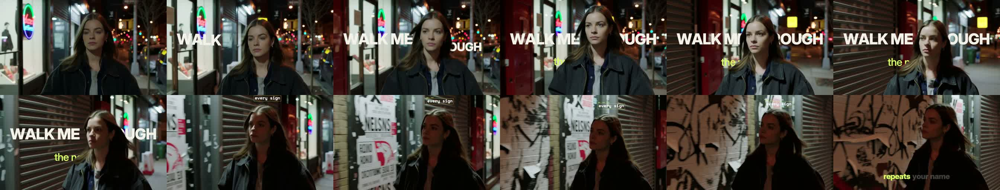
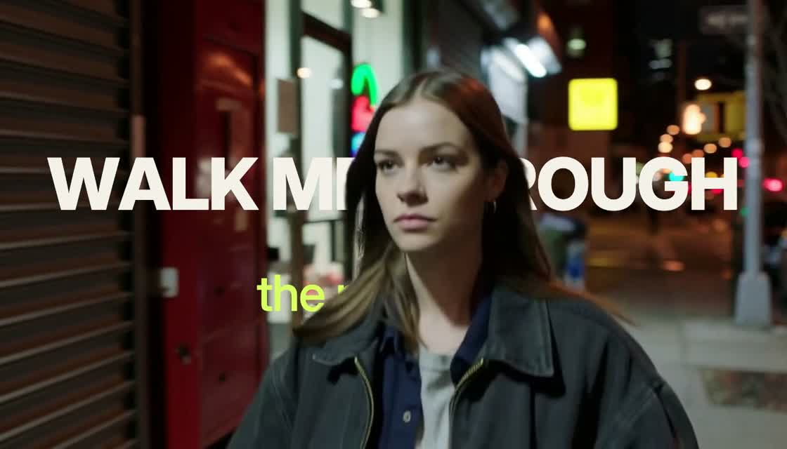
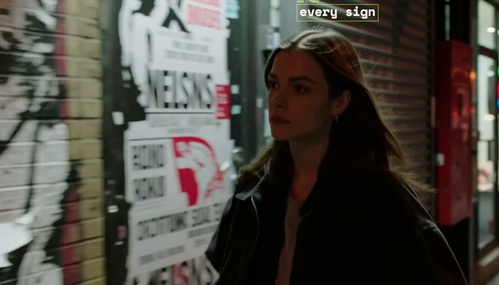
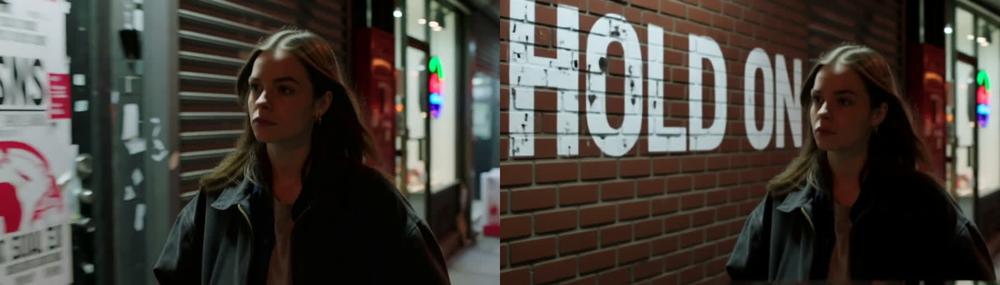
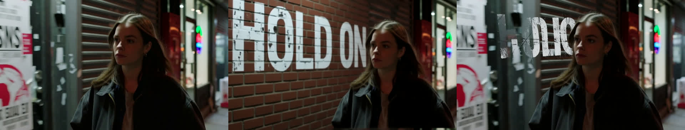
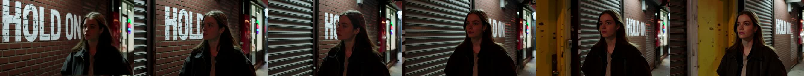
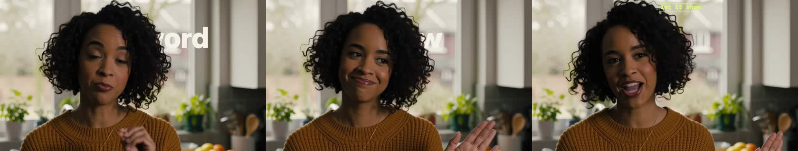
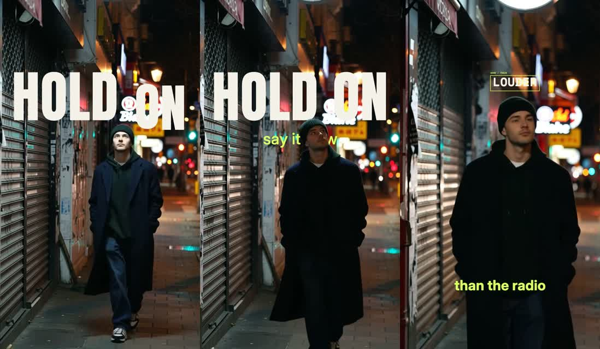
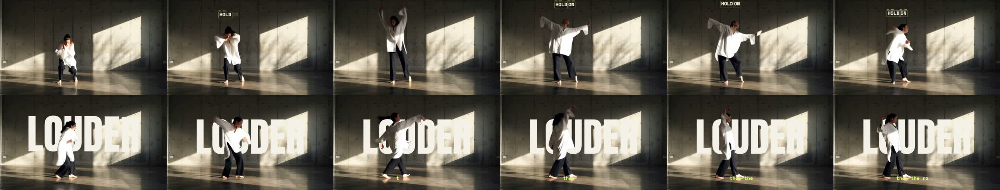
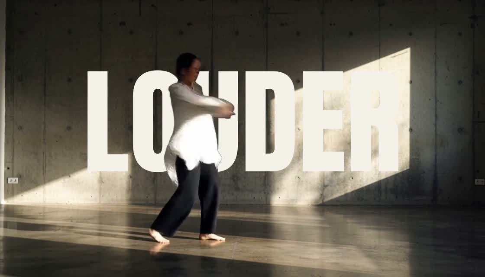

# Typeset — creative concept options (draft, 2026-10-31 ~00:30)

Written after reviewing the current showcase, the two example videos, the editor, the model evaluations, and the remote 4090's capabilities. The user's verdict on the current examples: lame. Diagnosis and three concept directions follow, each with what it needs from the existing infrastructure. Proof frames are being produced on generated test footage and will be linked under **Proofs** as they land.

## Why the current examples fall flat

| Example | What it shows | Why it reads as lame |
|---|---|---|
| NEON (Krea → MiniMax, 5 s) | A neon sign on a brick wall, slow push‑in | Nothing happens. No subject, no interaction, no before/after. It looks like stock footage; any T2V model does this. It also doesn't demonstrate *our* idea (words placed into footage). |
| Typography demo (12 s) | Spring‑pop captions over a gradient with a dark mannequin silhouette | No real footage, no real motion; the subject is a cylinder. The "behind" occlusion is technically there but visually there's nothing to be behind. Reads as an After Effects template. |
| Material studies (6 stills) | Words rendered as neon / paint / stone / thread | Pretty, but static, and spelling is the only thing being proven. Not a product. |

Common root cause: the fixtures prove the *pipeline*, not the *thesis*. The thesis is in the showcase headline already ("Words belong in the scene") and nothing on the page shows a word belonging to a scene with a real human in it.

## What the infrastructure can already do (so concepts stay honest)

- Word timing from speech/vocals (faster‑whisper, optional lyric alignment). Local.
- Per‑frame person cutout + bbox/head track (BiRefNet). Local. → **text behind the body**, **text that follows the head**.
- Deterministic spring/karaoke/typewriter/HUD presets; the renderer is small (86 lines) and easy to extend. Transparent ProRes 4444 / VP9 overlays + final MP4 export.
- Local image models with correct spelling: Z‑Image‑Turbo, FLUX.2 Klein 4B (t2i good; its *edit* dropped a letter), Qwen‑Image‑Edit‑2511 (edit spelled correctly, ~4.5 min/frame, changes geometry a little).
- Local LTX‑Video 2B: i2v and first/last‑frame morph in ~5–50 s.
- Remote 4090: Krea2 t2i (~14 s), **MiniMax H3** t2v/i2v with audio at 1344×768×5 s in ~3 min, plus first/last frame, guide‑image‑at‑frame, reference‑to‑video, SAM3 video tracking, MediaPipe face landmarks.
- Not available: hand/pose tracking locally (SAM3/MediaPipe exist locally as nodes but weights unverified), LTX‑2.x, real‑time.

## Concept A — "Captions that live in your footage" (lyric video, shot on a phone)

**One line:** you film yourself walking through the city at night; the lyrics of an original song appear *in* the street — behind you as you pass, riding on your head for a bar, and on the hook the word stops being a caption and becomes part of the wall.

**Beats (≈12–15 s):**
1. 0–4 s: raw handheld footage, no text. Words of line 1 pop up **behind** the subject; she walks in front of them (occlusion sells it instantly).
2. 4–7 s: one key word **tracks the head**, segcam‑style HUD bracket with a tiny ID tag; the jitter is the beat.
3. 7–8 s: cut on the downbeat. The hook word has been **written onto the wall** by Qwen‑Edit (paint/neon matching the plate) and MiniMax continues the camera move past it (i2v from the edited frame). 3–4 s.
4. 11–15 s: back to live footage; last line as karaoke fill, then the transparent overlay is shown peeling off (before/after).

**Why it works for the hackathon:** real footage + real motion; the generative moment is a *beat* with a reason; it's share‑native (vertical crop works); clear before/after; Open Weights Only if the generated shot uses local LTX instead of MiniMax (LTX 2B quality is weaker — judge with proofs); LTX bonus plausible if LTX does the hook shot.
**Needs:** user footage (phone, night, walking toward camera, 15–20 s), an ACE‑Step song, one Qwen‑Edit frame, one MiniMax/LTX i2v shot. All of which exist as tools today; what's missing is integrating the remote path into the editor's Generate button (currently CLI).
**Risk:** continuity between live footage and the generated shot; mitigated by cutting on the beat and matching the plate from the actual frame.

## Concept B — "Type with mass" (words obey the choreography)

**One line:** letters have weight. They drop on the beat, land on the dancer's shoulders, get swept by an arm, tumble to the floor and pile up; on the chorus the pile is one word and it changes material (first/last‑frame morph).

**Beats:** dancer in a hard‑lit studio (static camera). Words fall from above on each onset; collision with the body matte (letters rest on the silhouette's top surface, slide off when it moves); letters that pass behind the body are occluded; floor plane = bottom of the matte's bbox over time. Chorus word assembled from fallen letters → morph to chrome/flowers.
**Why:** the most *visual* idea; nobody has typography reacting physically to a person in a ComfyUI app; it is TouchDesigner‑brain in a web tool; it plays as a loop (Most Viral).
**Needs:** a deterministic 2D physics pass precomputed from frame 0 using the matte PNGs as collision (downsampled heightfield per frame) — ~1 day of renderer work; studio footage with big movement.
**Risk:** physics jank and time; the generative part is a garnish, so the LTX bonus is weaker. Strong for Most Innovative/Viral if it lands.

## Concept C — "The song annotates the world" (segcam lineage)

**One line:** everything in frame gets detected and labeled — but the labels are the lyrics. Faces, hands, lights, the passing car: the song's words attach to the things the camera sees, in monospaced brackets with leader lines, IDs and confidence readouts that are secretly beat energy.
**Beats:** verse: words land on detected regions (head, bright lights via threshold, moving regions via frame‑diff — exactly segcam's three segmenters, now plus SAM3/BiRefNet); chorus: the HUD collapses into one big word behind the subject; outro: the overlay layer peels off to show it's a layer you can drop into Resolve/TouchDesigner.
**Why:** a coherent, ownable aesthetic that is *already the user's*; honest about being CV; runs fully local (Open Weights Only); exportable as a layer = the "applies across platforms" story.
**Needs:** bright/motion segmenters as nodes (cheap: OpenCV threshold + frame‑diff in `typeset_nodes`), multi‑track support in tracks.json (already allowed), a richer HUD preset. No generative dependency unless added.
**Risk:** less "wow" for judges who expect generation; less of a clear Higgsfield‑feature rebuild.

## Recommendation

Lead with **A** as the hero example (it is the clearest demonstration of "words belong in the scene" and uses every layer of the stack), and borrow **C**'s HUD as the second movement so the user's signature look is visible. Keep **B** as a stretch: prototype the collision in a branch only after A is shot and cut.

Hackathon story in one breath: *"Video models can't spell. Typeset renders words with real fonts and lets ComfyUI decide where they belong — behind the person, on their head, on the wall — and when a word should become part of the world, an image model writes it and a video model moves it. Everything exports as layers for your editor."*

## Proofs

All proofs run on **generated test footage** (MiniMax H3 on the 4090, text‑to‑video, 1344×768, 5.2 s, ~2.7 min each) through the *existing* app pipeline (upload → matte → words → composite export), with no code changes. Project ids are kept so you can open them in the studio.

### Test footage
- `docs/concepts/footage_walk_night_sheet.jpg` — woman walking toward camera down a night street past shopfronts and a poster wall. Reads as real handheld footage.
- `docs/concepts/footage_dancer_sheet.jpg` — dancer in a concrete studio with a hard window‑light square on the wall; big gestures.
- `docs/concepts/footage_walk_vertical_sheet.jpg` — 768×1344 vertical: man in a beanie walking toward a phone camera past shutters and posters (answers "does 9:16 work": yes, same pipeline).
- `docs/concepts/footage_talk_closeup_sheet.jpg` — woman talking to camera in a kitchen (the mainstream *captions* use case, not just lyric videos).

### Proof A — walk: behind + head HUD + karaoke (project `beeba9e1-9178-4f24-b9ce-9fb119bb33f6`)

- "WALK ME THROUGH" **behind** her works immediately: clean hair‑edge occlusion, the word reads as a title card she walks in front of. This single frame is more convincing than the whole NEON clip.
- Head track held **124/124 frames**; the HUD label "every sign" followed her the full clip.
- Karaoke fill at the bottom is fine but generic — it's the control, not the point.
- **Design notes for the renderer:** (1) a `behind` word placed at body height disappeared entirely behind her torso ("the neon rain") → `behind` placement should auto‑offset away from the track bbox, or we expose a "keep visible" toggle; (2) the HUD needs to be bigger with a leader line to the head and a less tiny tag; (3) word pop‑in should be staggered per word on onsets, not per line.

Export timing: matte ≈ 1 min for 124 frames at 1344×768 locally; composite export 87 s.

### Proof A, beat 3 — the word becomes part of the wall (Qwen‑Image‑Edit‑2511, local, 477 s at 896×512)

- Spelling exact ("HOLD ON"), convincing weathered paint, correct perspective and night lighting, the person untouched.
- **But** the model replaced the poster‑covered shutters with a clean brick wall — the known geometry drift. As a *cut* on the downbeat it can read as "the world answers the song"; as "the word appears on *your* wall" it is a lie.
- **Consequence for the product:** add a deterministic **`surface` placement** — the vector text warped onto a quad the user drags onto the wall (4 corners, or auto from the matte/depth), occluded by the person. Exact footage, exact spelling, zero model time, works on every clip. Generation then becomes an *optional material pass* (paint/neon texture via img2img on the text region only, or the full MiniMax continuation for a stylized beat). This is also a far better story for judges: "we don't ask the model to spell; we ask it to light."
- **Klein 4B comparison** (original / Qwen / Klein):  Klein kept the scene perfectly (posters, shutters, framing) but misspelled the word as "HOLIC", rendered half‑transparent over the posters. Qwen spells correctly but rewrites the wall; Klein preserves the wall but can't spell. Neither gives both, which settles it: the deterministic `surface` placement is the default and the models are the optional material pass.
- **MiniMax continuation from the Qwen frame** (4090, ~2.7 min, 5 s):  The painted HOLD ON stays on the wall with believable parallax as the camera tracks her, and she stays consistent. But the street keeps reinventing itself: shutters appear, yellow doors appear, and a second "HOLD ON" shows up further down the wall. Usable as a 2–3 s stylized beat cut on the drop, not as continuity with the real clip.

### Proof D — talking head: captions behind the speaker (project `400b4ae2-270c-490e-80b0-40c963d5045e`) — a failure worth keeping

This one fails, and it's instructive. In a close‑up the subject fills the frame, so captions placed "behind" her are mostly hidden ("…ord", "…w"), and the HUD label clipped off the top of the frame. Fixed positions don't work when the subject is large. The renderer has to *place* `behind` text where the matte leaves room: find the largest free region in the matte over the word's time span and fit the text there. That logic is the real product, more than any preset. It is also a much better demo moment than another preset: "you choose behind; Typeset finds where behind can be read."

### Proof A2 — vertical 9:16 (project `3a5286d6-01b3-4513-bf13-d4d63e048969`)

The same pipeline works vertically: HOLD ON behind him, a HUD label on his head, and a karaoke line at the bottom. The behind‑title is a cliché on vertical (it covers the sign area), but it reads instantly on a phone.

### The demo song — original, open weights (ACE‑Step 1.5 turbo, local, 32 s, ~80 s compute + queue)

Audio: `outputs/concept-tests/song/neon_rain_00001.flac` (48 kHz stereo). Lyrics and prompt: `outputs/concept-tests/song/song.json`; graph: `workflows/eval/ace_song.api.json`. Whisper (small) hears:

| time | heard | written |
|---|---|---|
| 0.0–7.1 | Walk me through the neon rain / Every time repeat your name | …Every **sign repeats** your name |
| 11.6–16.3 | Hold on, say the **soul** / **Loud as under** radio | Hold on, say it **slow** / **Louder than the** radio |
| 17.0–21.4 | Hold on, let it show / Every word I know | ✓ |
| 24.2–26.1 | Every word I know | ✓ |

The vocal sings our lyrics; Whisper mishears 3 phrases. That is exactly the case the lyric‑alignment step exists for (keep Whisper's timings, take the spelling from the lyrics), so the song doubles as a good live demo of "paste your lyrics → exact words, sung timing". Hook words at usable times: WALK (0 s), HOLD ON (11.6 s, 17.0 s), LOUDER (~14 s), EVERY WORD I KNOW (19 s / 24 s).

Gotcha found: in the ComfyUI venv, faster‑whisper's file decoding breaks on the installed PyAV version (`metadata_errors` kwarg). Passing a numpy array works. The `words` workflow feeds tensors from LoadAudio so it should be unaffected, but worth a check before the demo.

### Proof C — dancer: head HUD + giant word behind (project `eda6abeb-de19-4313-ba38-a83d1d1002bf`)

- A wall‑sized **LOUDER** behind the dancer, with her arms and body cutting in front of the letters, is the most *graphic* frame of the night — it looks like a poster that moves. Track held 124/124 frames with big motion; the HUD label stayed on her head through turns.
- Legibility note: white shirt against white letters merges in places → auto‑contrast against the subject (or a one‑pixel dark edge/shadow on `behind` words) belongs in the renderer backlog.
- This footage is also the right test bed for **Concept B** (letters colliding with the body): the matte is clean and the floor plane is obvious. Not prototyped yet.

## Open questions for the user

1. Shoot your own footage Saturday (15–20 s, night, walking toward a phone camera, some wall/shopfront behind you)? Or use generated footage for the demo and say so?
2. Vertical (9:16, share‑native) or landscape (16:9, event screen)? Both is possible from the same shoot if framed loose.
3. Song: ACE‑Step generated with lyrics we write (clean rights) vs. a track you own.
4. Which concept is the hero: A, B, or C?
